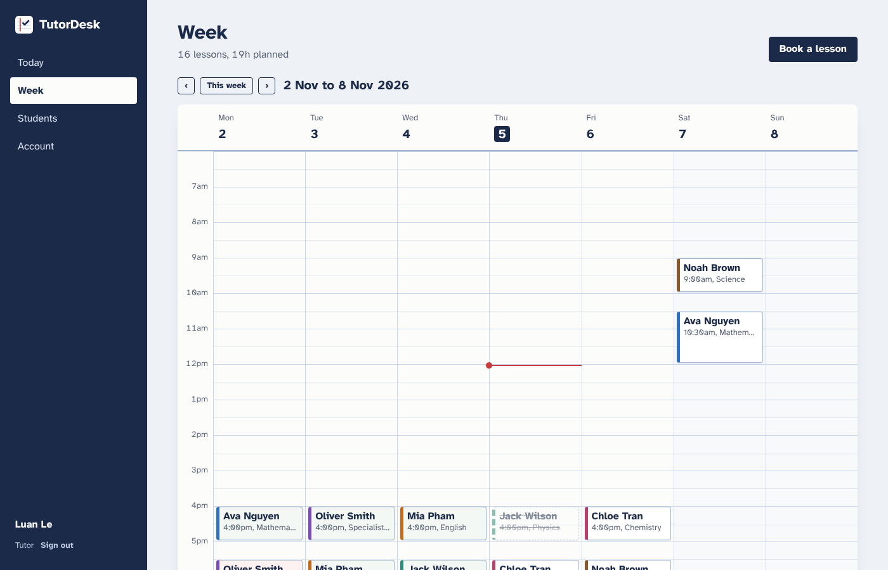
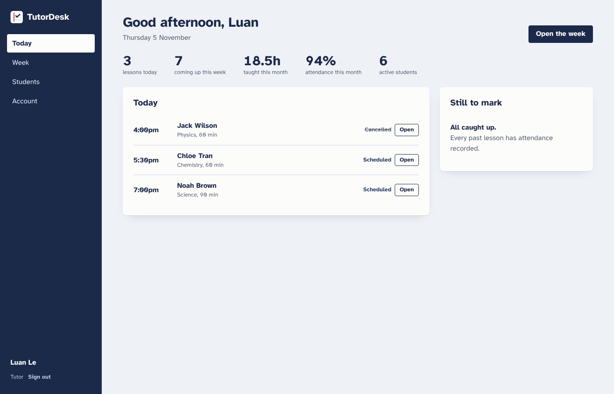
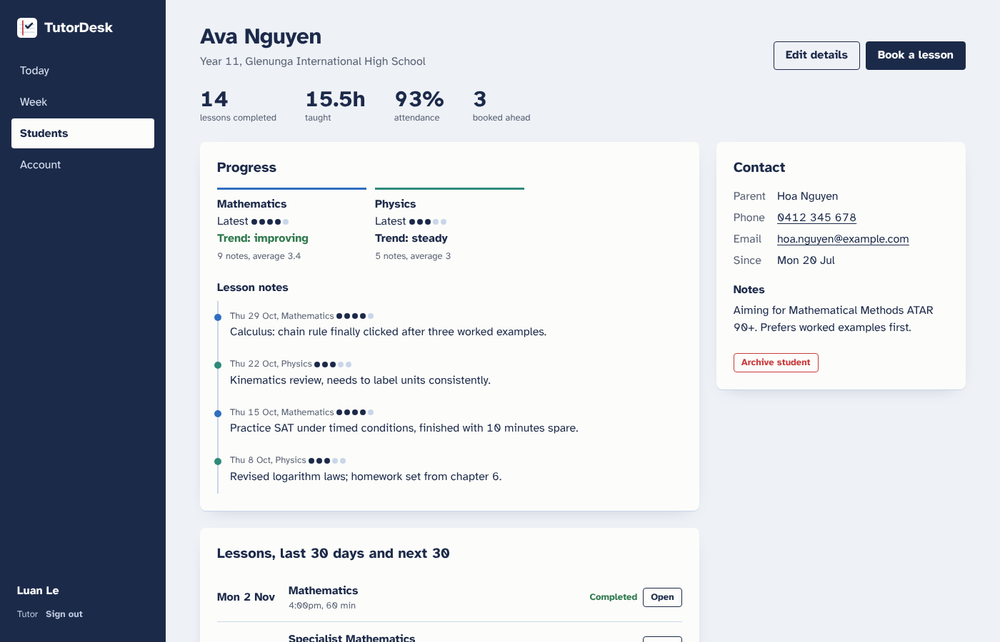
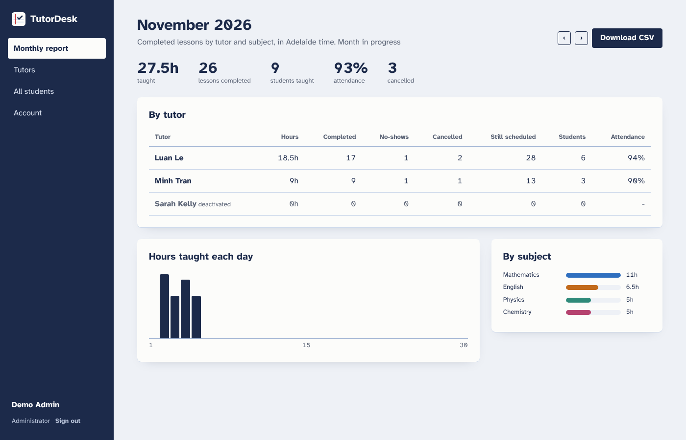
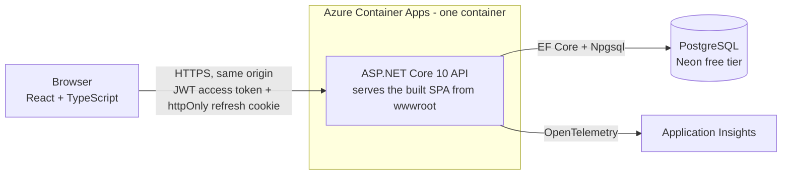
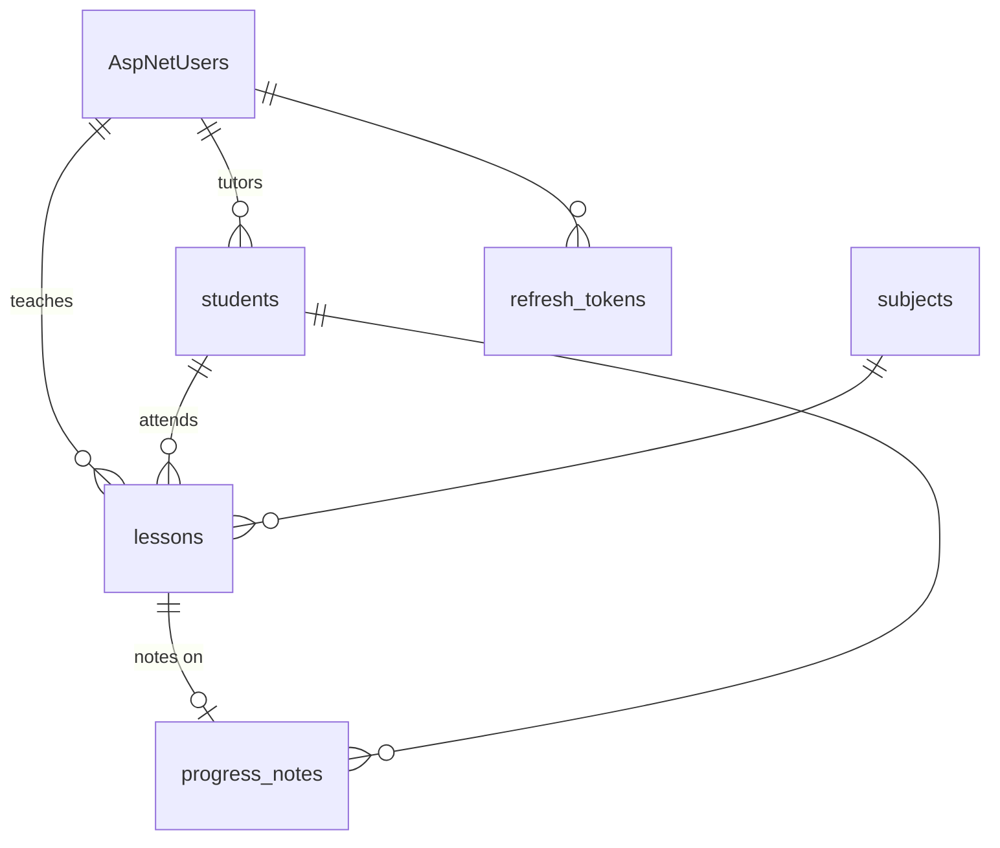
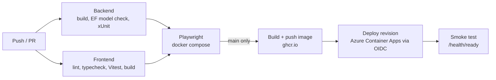

# TutorDesk

A scheduling and progress-tracking app for independent tutors. Tutors book weekly lessons, record
attendance and progress notes, and see their week on one page. An admin manages tutors and gets a
monthly hours report.

It grew out of my own tutoring work at Tutor2you, where lessons, attendance and parent updates
lived in a spreadsheet and a group chat.

**Live demo:** _add after the first Azure deploy_ · sign in as `tutor@tutordesk.demo` or
`admin@tutordesk.demo`, password `Demo!2345`




## What it does

**Tutors**
- Week timetable, ruled like an exercise book. Lessons that have started but aren't marked are highlighted.
- Book single lessons or weekly series (up to 12 weeks). A series keeps its Adelaide wall-clock time across daylight-saving changes.
- Clash detection for the tutor and the student. A series is all-or-nothing, and the clashing dates are listed.
- Record attendance (completed or no-show), with a progress note and a 1–5 "understanding" rating.
- Per-subject progress with a trend (improving / steady / declining), plus a student history.
- Reschedule, cancel (optionally the rest of a series), archive and restore students.

**Admin**
- Add tutors and deactivate them. Deactivation signs the tutor out immediately, including tokens already issued.
- Monthly report: hours, completed lessons, no-shows, cancellations and attendance rate per tutor and per subject. Downloadable as CSV, with spreadsheet formula injection neutralised.

| Today | Student progress | Monthly report |
|---|---|---|
|  |  |  |

## Architecture



- **One container** serves the API and the React build. Being same-origin means no CORS, and the
  refresh token can be an `httpOnly`, `SameSite=Strict` cookie scoped to `/api/auth`.
- **Feature folders** in the API (`Features/Students`, `Features/Lessons`, ...). Each has DTOs, a
  service with the rules, and a thin controller. Scheduling rules are pure functions
  (`LessonRules`) so they can be unit-tested without a database.
- **Time:** everything is stored in UTC. Business rules that are "local" (weekly repeats, business
  hours, "today", monthly reports) go through `AdelaideTime`. The clock is an injected
  `TimeProvider`, so tests can move time.

### Data model



## Engineering decisions worth asking me about

| Problem | What I did |
|---|---|
| Two booking requests racing for the same slot | App-level overlap check **and** a Postgres exclusion constraint (`EXCLUDE USING gist (TutorId WITH =, tstzrange(...) WITH &&) WHERE Status <> 'Cancelled'`). A violation becomes a 409. Covered by a test that fires 6 concurrent bookings and expects exactly one 201. |
| Two people editing the same student | Optimistic concurrency on Postgres `xmin`. Clients send the `version` they read; a stale one gets a 409 and the UI asks them to reload. |
| Daylight saving | A weekly 4pm lesson stays at 4pm when DST ends (its UTC time moves). Monthly reports use Adelaide month boundaries: a 7am lesson on 1 December is 30 November in UTC but counts in December. Both have tests. |
| Stolen refresh tokens | Refresh tokens rotate on every use and only their SHA-256 is stored. Re-using an old one revokes all of that user's sessions. |
| A deactivated tutor with a valid access token | `OnTokenValidated` checks the user is still active on each request, so access ends immediately rather than when the token expires. |
| Leaking other tutors' data | Every query is scoped to the current tutor. Another tutor's student returns **404, not 403**, so the API doesn't reveal that it exists. |
| Debugging production errors | Every error is RFC 9457 problem+json with a `traceId` that matches the trace in Application Insights. Custom metrics track bookings, conflicts and attendance outcomes. |

## Tests

| Layer | Tool | What's covered |
|---|---|---|
| Backend unit | xUnit | Scheduling rules, DST expansion, Adelaide month ranges, progress trend, CSV escaping, JWT issuing |
| Backend integration | xUnit + `WebApplicationFactory` + Testcontainers (real Postgres) | Auth flows (lockout, refresh rotation and reuse, logout, deactivation), role and tutor isolation, validation, conflicts, the concurrency race, optimistic locking, attendance rules, reports across DST and month boundaries, health checks and security headers |
| Frontend | Vitest + Testing Library + MSW | API client refresh-and-retry, forms and server error mapping, calendar positioning, attendance and cancel flows, routing guards |
| End-to-end | Playwright on the Docker Compose stack | Sign-in and session restore, add student, book a weekly series, clash, cancel the series, mark attendance, see the note, admin report and CSV, deactivating a signed-in tutor; smoke test on a mobile viewport |

CI runs all four layers on every pull request. The image is published and deployed only from `main`
after everything passes.



## Run it locally

**Everything in Docker** (http://localhost:8080, Swagger at `/swagger`):

```bash
docker compose up --build
```

**Developing** (hot reload):

```bash
docker compose up -d db
cd backend && dotnet run --project src/TutorDesk.Api --urls http://localhost:5080   # seeds demo data in Development
cd frontend && npm install && npm run dev                                           # http://localhost:5173, proxies /api
```

**Tests:**

```bash
cd backend && dotnet test            # needs Docker for Testcontainers
cd frontend && npm test
cd e2e && npm ci && npx playwright install chromium && npx playwright test   # against docker compose
```

## Deploy

Runs for $0/month: Azure Container Apps (scales to zero, inside the free grant), Neon's free
Postgres, Application Insights with a daily log cap, and an Azure budget alert as a safety net.
[docs/deploy-azure.md](docs/deploy-azure.md) has the steps: one Bicep deployment, plus OIDC
federated credentials so GitHub Actions deploys without a stored Azure secret.

## Project layout

```
backend/
  src/TutorDesk.Api/      Domain, Data (EF Core + migrations), Auth, Common, Features/*
  tests/TutorDesk.Api.Tests/  Unit/ and Integration/ (Testcontainers)
frontend/                 React 19 + TypeScript + Vite, TanStack Query, react-hook-form + zod
e2e/                      Playwright
infra/                    Bicep
.github/workflows/        CI/CD, EF migration generator
```

## Tech

ASP.NET Core 10 · EF Core 10 + Npgsql · ASP.NET Core Identity · JWT · PostgreSQL (Neon) · React 19 ·
TypeScript · Vite · TanStack Query · Vitest · Playwright · Docker · GitHub Actions · Azure Container
Apps · Bicep · Application Insights (OpenTelemetry)
